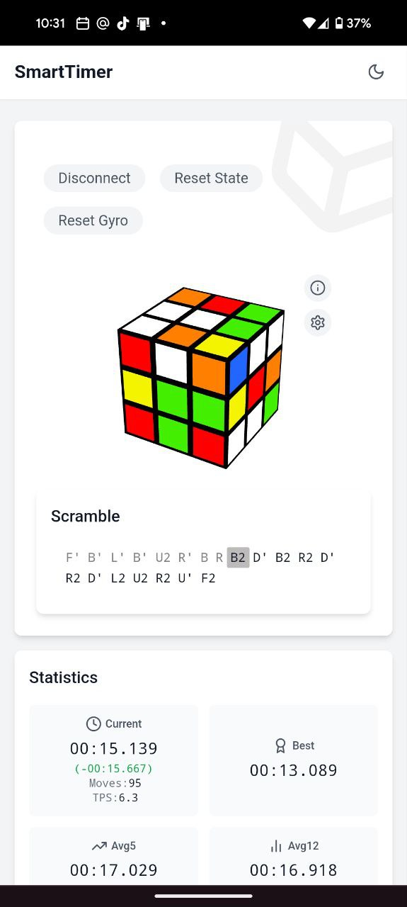
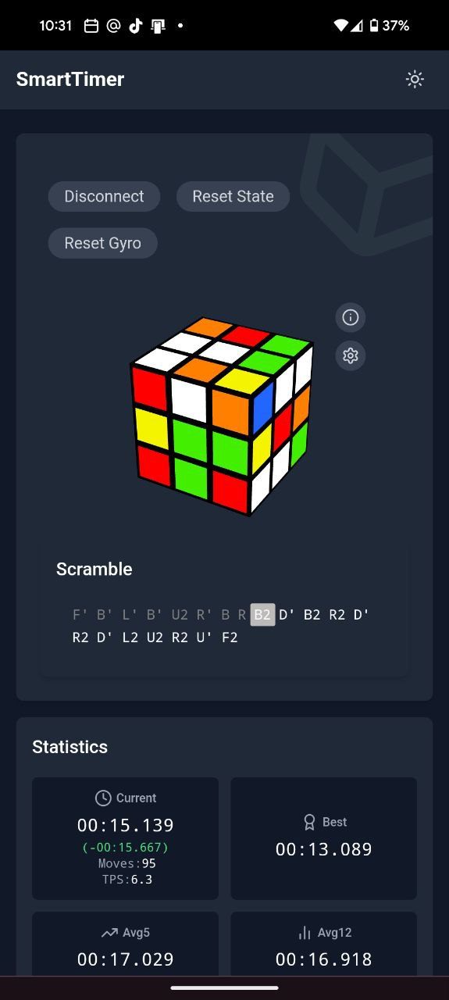
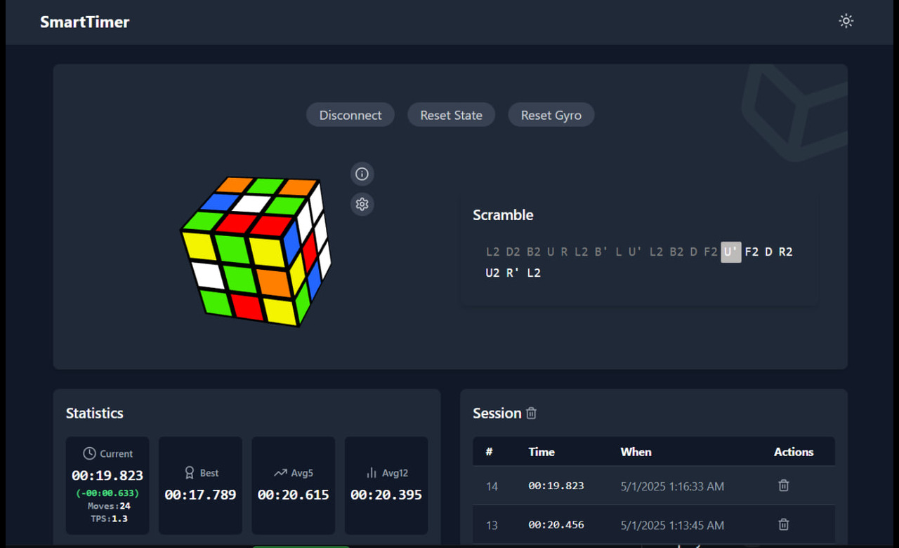
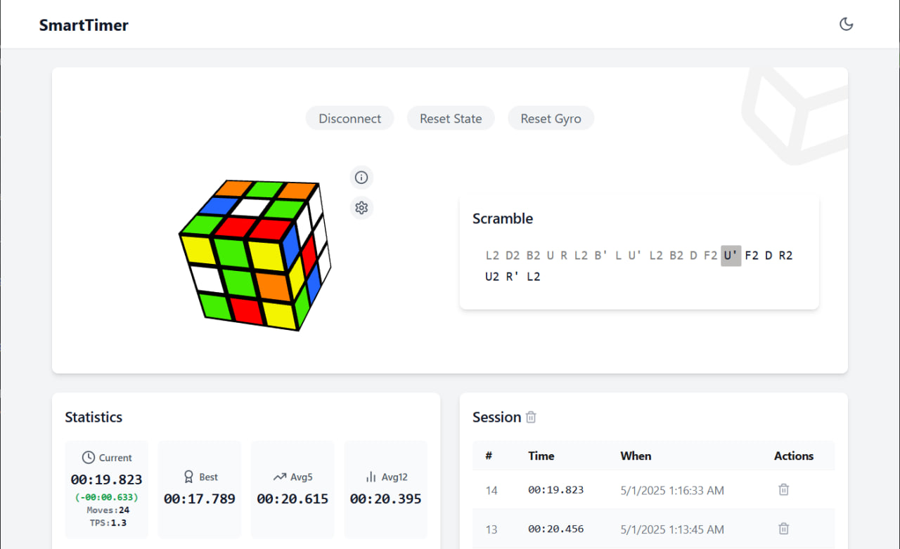

# 🚀 Smart Cube Timer

*A modern [PWA](https://en.wikipedia.org/wiki/Progressive_web_app) speedcubing timer with smart GAN cube support*

[](https://sheshkon.github.io/smart-cube-timer/)

## 🎥 Demo

https://github.com/user-attachments/assets/2c502ddf-ec6e-4e24-aba7-4e4641a9345b

<!-- 
<div align="center">
  
  
  
  <em>Fig 1. Mobile interface (Light/Dark/Stats)</em>
</div>

<div align="center">
  
  
  
  <em>Fig 2. Desktop interface (Dark/Light/Extended Statistics)</em>
</div>

<div align="center">
  
  
  
  <em>Fig 3. Key Features: Connection, Analysis, Sharing</em>
</div>
-->

## ✨ Features

### ⏱️ Core timer

- Millisecond-accurate timing with optional WCA-style inspection
- WCA random scrambles via [cubing.js](https://js.cubing.net/cubing/)
- Draggable, reorderable UI blocks (timer, cube, stats, table, charts)
- Multiple sessions with rename, delete, and per-session bests
- Milestone toasts (personal bests, every N solves)

### 🤖 Smart cube integration

- Bluetooth LE via [gan-web-bluetooth](https://github.com/afedotov/gan-web-bluetooth)
- Live 3D cube ([TwistyPlayer](https://js.cubing.net/cubing/twisty/), PG3D) synced with hardware moves
- Optional scramble hint arrows on the 3D cube during setup
- Solve reconstruction, move-per-second (TPS), CFOP / Roux step detection
- Battery level and device info
- Connection history (per device MAC, session duration, disconnect reason)

### 📱 App modes

Modes are available when a smart cube is connected (except **Session**, which also works offline without BLE):

| Mode | Purpose |
|------|---------|
| **Session** | Standard timed solves with full stats |
| **Training** | Algorithm practice: scrambles from a formulas sheet, setup progress, optional solution hints |
| **Mini games** | Control mini games with cube turns and/or gyro — Asteroids, Rally, Doodle Jump |

### 📊 Analytics

- **Session stats**: Ao5, Ao12, Ao100, mean, best, solve list with pagination
- **Extended statistics** (modal): progress charts, time distribution, method breakdown, TPS charts
- **Solve chart**: timeline of moves and recognized steps for a single solve

### 📚 Formulas library

- Separate route: browse algorithm categories and groups (same sheet source as training mode)
- Useful reference without starting a training session

### 🔗 Sharing & backup

- Shareable links and QR codes for individual solves
- Export / import session database (IndexedDB via Dexie)
- Optional Google sign-in and Google Drive backup of solve data

### 🎨 Customization

- Light / dark UI
- Background themes (Solid, Accent stripe, Ink) and custom accent color picker
- Scramble size, solves per page, image move notation
- Gyroscope toggle (mini games and optional steering)
- Toggle inspection, solve analysis chart, cube animation, scramble arrows

### 🧰 Developer / power user

- In-app debug console (toggle in header)
- PWA install and offline caching (vite-plugin-pwa)

## 🙏 Credits

- [gan-web-bluetooth](https://github.com/afedotov/gan-web-bluetooth) — Web Bluetooth stack for GAN smart cubes
- [cubing.js](https://github.com/cubing/cubing.js) — scrambles, algorithms, TwistyPlayer 3D

### Supported smart cube devices

**GAN Gen2 protocol**

- GAN Mini ui FreePlay
- GAN12 ui FreePlay
- GAN12 ui
- GAN356 i Carry S
- GAN356 i Carry
- GAN356 i 3
- Monster Go 3Ai
- MoYu AI 2023 (GAN Gen2 protocol)

**GAN Gen3 protocol**

- GAN356 i Carry 2

**GAN Gen4 protocol**

- GAN12 ui Maglev
- GAN14 ui FreePlay

## 🛠️ Tech stack

| Category | Technologies |
|----------|--------------|
| Frontend | React 19, Vite (rolldown-vite), JavaScript |
| State | React Context + Providers |
| Styling | Tailwind CSS 3, DaisyUI 5 |
| UI / charts | MUI 7, MUI X Charts, Lucide / React Icons |
| 3D / puzzles | cubing.js 0.66+ (TwistyPlayer), Three.js (hint arrows) |
| Bluetooth | Web Bluetooth API, gan-web-bluetooth 3.x |
| Storage | Dexie 4, dexie-export-import, localStorage settings |
| PWA | vite-plugin-pwa (Workbox) |
| Auth (optional) | Google OAuth, Google Drive API |
| Deployment | GitHub Pages |

## 🚀 Getting started

### Prerequisites

- **Chrome / Edge 89+** (recommended for Web Bluetooth)
- Bluetooth adapter and a supported smart cube (for BLE features)
- Optional: enable experimental platform features if BLE pairing fails — `chrome://flags/#enable-experimental-web-platform-features`
- Device list for debugging: `chrome://bluetooth-internals/#devices`

### Installation

```bash
git clone https://github.com/sheshkon/smart-cube-timer.git
cd smart-cube-timer
npm install
npm run dev
```

### Scripts

| Command | Description |
|---------|-------------|
| `npm run dev` | Local dev server |
| `npm run host` | Dev server on LAN (`--host`) |
| `npm run build` | Production build |
| `npm run preview` | Preview production build |
| `npm run lint` / `lint:fix` | ESLint |
| `npm run format` | Prettier |

### Optional: Google Drive backup

Create `.env` (or set in CI) with a Google OAuth client ID used by the app:

```env
VITE_GOOGLE_CLIENT_ID=your-client-id.apps.googleusercontent.com
```

Without it, local file export/import still works.

## ℹ️ Compatibility

### iOS limitations

⚠️ **iPhone / iPad are not supported for smart-cube Bluetooth** because mobile Safari lacks a practical Web Bluetooth API.

**Workarounds:**

1. **macOS** — Chrome or Edge with a supported cube
2. **Android** — Chrome 89+
3. **Timers only** — use Session mode without BLE (manual timing + scrambles)
4. Experimental: [Web Bluetooth polyfill](https://github.com/WebBluetoothCG/web-bluetooth-polyfill) (limited)

We track [WebKit Web Bluetooth status](https://webkit.org/status/#specification-web-bluetooth) for future iOS support.

### Android APK (TWA)

#### Install Bubblewrap

```bash
npm i -g @bubblewrap/cli
```

#### Init / update / build

```bash
bubblewrap init --manifest https://sheshkon.github.io/smart-cube-timer/manifest.webmanifest
bubblewrap update
bubblewrap build
```

Alternative packaging: [PWABuilder](https://www.pwabuilder.com/)